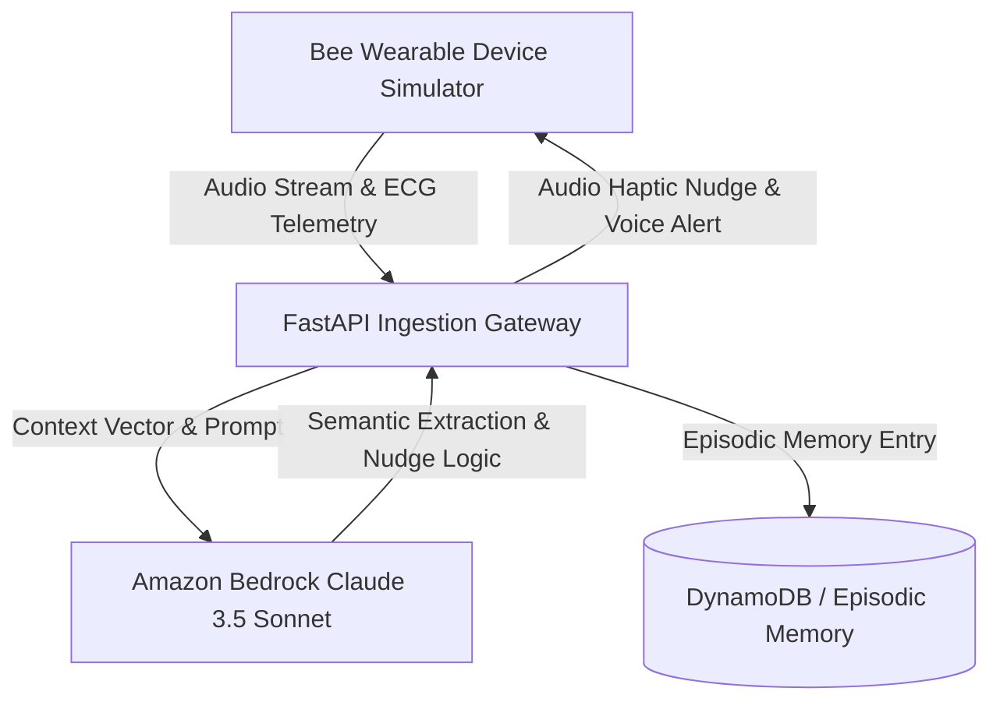

# 🐝 BeeSense AI: Ambient Wearable Copilot & Second Brain

[](https://aws.amazon.com/bedrock/)
[](https://python.org)
[](https://fastapi.tiangolo.com)
[](https://opensource.org/licenses/MIT)

> Built for the **Build, Ship, Shape: Amazon Developer Hackathon 2026**  
> **Track:** Bee (Wearable AI) + AWS Builder Mini-Challenge + Open Source Track

---

## 🌟 What is BeeSense AI?
**BeeSense AI** is an enterprise-grade ambient wearable intelligence system powered by **Amazon Bedrock (Claude 3.5 Sonnet)**. It continuously transforms ambient audio and biometric telemetry into proactive micro-nudges, real-time stress wellness alerts, and episodic conversational memory recall.

---

## ✨ Key Features

1. 🎙️ **Live Multimodal Ambient Ingestion:** Real-time microphone audio processing with simulated sensor telemetry (ECG heart rate, location, and motion activity).
2. 🔊 **Voice Speech Synthesis (TTS):** Natural assistant audio feedback for nudges and memory recalls.
3. 📈 **Real-Time Biometric ECG Telemetry:** Live Chart.js telemetry monitor simulating user stress states.
4. 🧠 **Amazon Bedrock Context Engine:** Zero-touch action-item extraction and natural-language "Second Brain" episodic memory querying.
5. ⚡ **Plug-and-Play Simulator:** Zero-config local mock engine allows instant testing and judge evaluation.

---

## 🏗️ Architecture



---

## 🚀 Quick Start Guide

### 1. Clone & Setup
```bash
git clone https://github.com/<your-username>/beesense-ai.git
cd beesense-ai
py -m pip install -r requirements.txt
```

### 2. Configure AWS Bedrock (Optional)
```bash
cp .env.example .env
# Fill in AWS_ACCESS_KEY_ID & AWS_SECRET_ACCESS_KEY
```

### 3. Launch the Simulator
```bash
py -m uvicorn main:app --reload --port 8000
```
Open **[http://localhost:8000](http://localhost:8000)** in your browser!

---

## 🏆 Hackathon Tracks & Badges
- **Track:** Bee (Wearable AI)
- **AWS Builder Challenge:** Amazon Bedrock (Claude 3.5 Sonnet), AWS Lambda architecture, DynamoDB episodic store.
- **Open Source Track:** Permissive MIT License open-source wearable simulator SDK.
